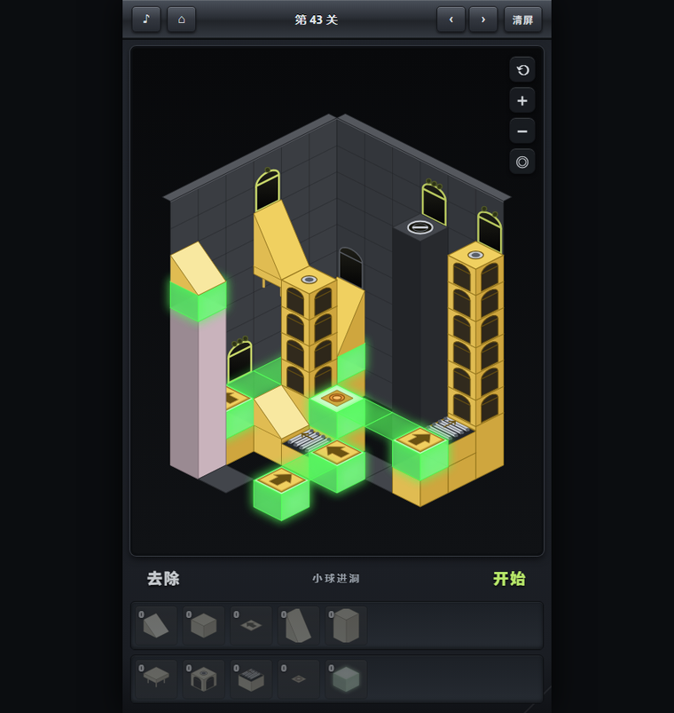
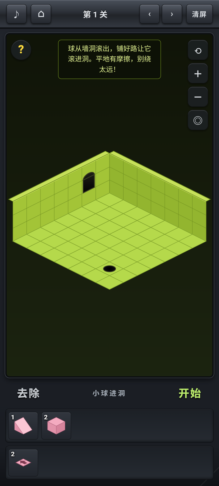
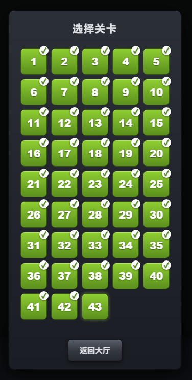
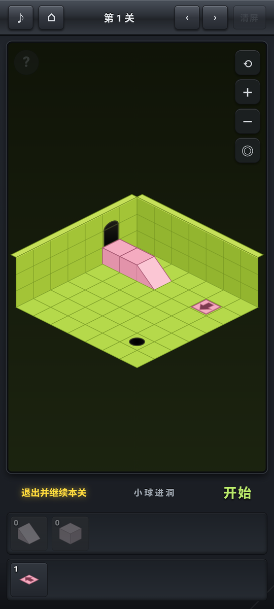

# Isoball Mobile · 小球进洞（手机版）

> *Isoball* 玩法的中文重制版 —— 网页版 + 安卓 WebView 壳，共 **43 关**。

把底边栏里的积木摆到盘面上，让小球从墙洞滚出来，一路滚进洞里。小球滚动过程中会因摩擦损失动能，所以路线需规划好，保证球最终能滚进洞里。

## 游戏截图

<p align="center">
  
</p>
<p align="center"><sub>第 43 关</sub></p>

<p align="center">
  
  
  
</p>
<p align="center"><sub>手机版：游玩界面 / 关卡选择界面 / 关卡提示（点左上角 <code>?</code> 展示通关摆法）</sub></p>

## 特性

- **43 关**，逐步引入新机制：斜坡 → 箭头 → 桥 → 电梯 → 传送带 → 按钮/立柱 → 荧光块（光桥）
- **等距 3D 渲染**，四种视角（主视角 / 右墙 / 左墙 / 俯视），支持双指缩放、单指平移、双击复原
- **手机优先**：锁竖屏、触屏拖拽放积木；积木放下后弹出 44px 圆形浮钮（确认 / 旋转 / 收回），视角与提示按钮 38px
- **关卡提示**：点左上角 `?` 会按每关记录的 `sol` 摆出通关走法，可「退出并继续本关」回到自己的摆法
- **三存档位**，进度存在浏览器 localStorage，并做了一份双写备份

## 目录结构

```
isoball-x/                网页版（电脑上直接开 index.html 就能玩）
  www/                    ★ 游戏源码（唯一主稿，改这里）
    index.html
    css/style.css
    js/sim.js             物理与规则引擎（滚动 / 斜坡 / 桥 / 传送门 / 电梯 / 立柱 / 光带）
    js/levels.js          43 关数据（地图 / 出生点 / 洞 / 积木库存 / sol 解法）
    js/render.js          等距渲染
    js/game.js            交互与状态机（放置 / 开始复位 / 存档 / 选关 / 提示）
    js/audio.js           音效（WebAudio 实时合成，无音频文件）
  tools/                  开发期验证脚本（不参与游戏运行）
  shots/                  验收截图（不入库）

mobile-isoball/           安卓外壳工程
  www/                    源码副本（打包中转）
  android/                Gradle 工程：全屏 WebView 加载 assets/www，?app=1 标记手机版
    app/src/main/java/com/smallball/isoball/MainActivity.java
    app/src/main/assets/www/   ← 真正打进 APK 的那份源码

Isoball-Mobile.apk        已构建好的安装包，直接装即可
```

## 运行

**网页版**：用浏览器打开 `isoball-x/www/index.html`（Chrome / Edge 最佳）。

**手机版**：安装根目录的 `Isoball-Mobile.apk`（Android 7.0+，`minSdk 24`）。

## 构建 APK

一套源码、三份副本，**顺序不能乱** —— 改完必须先同步再打包，否则会打出旧代码的包：

```bash
# 1. 同步源码（isoball-x/www 是唯一主稿，另外两份都从它复制）
cp -a isoball-x/www/. mobile-isoball/www/
cp -a isoball-x/www/. mobile-isoball/android/app/src/main/assets/www/

# 2. 打包（需要 Gradle 8.13 + Android SDK 34 + JDK 17）
gradle -p mobile-isoball/android assembleDebug

# 3. 产物复制到根目录
cp mobile-isoball/android/app/build/outputs/apk/debug/app-debug.apk Isoball-Mobile.apk
```

产物位置：`mobile-isoball/android/app/build/outputs/apk/debug/app-debug.apk`。

> 仓库里没有 `gradlew`，用的是本机安装的 Gradle。想让它自包含（换个环境也能直接打包），
> 在 `mobile-isoball/android` 下执行一次 `gradle wrapper`，再把生成的 `gradlew` 和 `gradle/wrapper/` 一起提交即可。

## 关卡数据格式（`js/levels.js`）

```js
{
  theme: 'olive',                       // 房间/积木配色
  tip: '……',                            // 进关提示（空串=不显示）
  W: 6, H: 6,                           // 盘面尺寸
  map: ['000060', ...],                 // 每格地形高度（'.'=虚空）
  start: { wall: 'L', idx: 3, z: 0, v0: 3.6 }, // 出生墙/行(列)/高度/初速
  hole: { c: 4, r: 1, z: 0 },           // 洞的位置与高度
  portals: [{ wall: 'R', idx: 5, z: 0, lights: 1 }], // 传送门（lights 相同即成对）
  pillars: [{ c: 3, r: 3, h: 2 }],      // 立柱（h=凸起高度，按钮触发下降）
  pieces: { block1: 2, ramp1: 3, ... }, // 积木库存
  sol: [{ p: 'ramp1', c: 1, r: 2, rot: 0 }, ...], // 通关解法（提示用）
}
```

## 开发工具（`isoball-x/tools/`）

| 脚本 | 作用 |
|---|---|
| `verify.js` | 跑一遍全部关卡的 `sol`，确认都能通关（当前 43/43） |
| `test-rules.js` | 规则单元测试：桥依附/塌陷、立柱连带下降、传送门、光带、电梯……（138 条） |
| `check-levels.js` | 关卡数据完整性检查（尺寸、门位置高度等） |
| `audit-ball-center.js` | 审计球是否贴着格子边滚（应始终走中心线） |
| `apk-verify.py` | 校验已构建 APK 内的资源/版本号是否与源码一致 |
| `trace-l*.js`、`try-l*.js` | 单关排查脚本（打印球路轨迹 / 枚举解法） |

```bash
node tools/verify.js          # 43 通过 / 0 失败 / 0 跳过
node tools/test-rules.js      # 138 通过 / 0 失败
node tools/check-levels.js    # 43 关，问题 0 关
node tools/audit-ball-center.js
```

## 关于开发方式

这个项目是 **Vibe Coding** 的产物：玩法规则、关卡设计和验收标准由人定义，代码实现与验证主要和 AI 协作完成。

- **人**：定规则（桥怎么塌、立柱怎么降、传送门怎么开洞）、设计 43 关的布局与积木配置、逐关试玩并反馈
- **AI**：实现物理引擎 / 等距渲染 / 交互、推演并校验每关的 `sol`、写回归测试、打包 APK 并在安卓模拟器上真机验证

所以 `tools/` 那套脚本不是附属品，而是这种协作方式能收敛的关键：每次改动都要 `verify`（43 关是否都能通关）
+ `test-rules`（138 条规则用例）全绿才算通过，改关卡就得同步重推 `sol`，否则提示功能会给玩家一盘走不通的棋。

## 说明

本项目是对 Flash 游戏 *Isoball* 玩法的中文重制，仅用于学习参考，原作版权归原作者所有。
